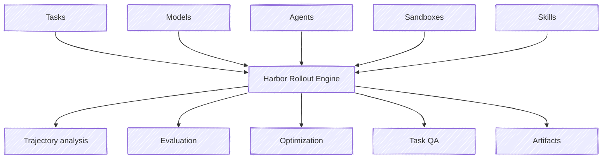

Harbor（智能体评测框架）可在任意沙箱中并行运行任意智能体、模型和任务。

<CardGroup cols={2}>
  <Card
    title="快速开始"
    icon="zap"
    href="/getting-started/quick-start"
  >
    使用 Harbor 运行首次评测。
  </Card>
  <Card
    title="运行任务"
    icon="terminal"
    href="/jobs/run-a-job"
  >
    在任务和数据集上运行智能体。
  </Card>
  <Card
    title="任务概览"
    icon="folder"
    href="/tasks/overview"
  >
    了解 Harbor 任务格式。
  </Card>
  <Card
    title="创建任务"
    icon="plus"
    href="/tutorials/create-a-task"
  >
    创建并测试你的第一个任务。
  </Card>
</CardGroup>
