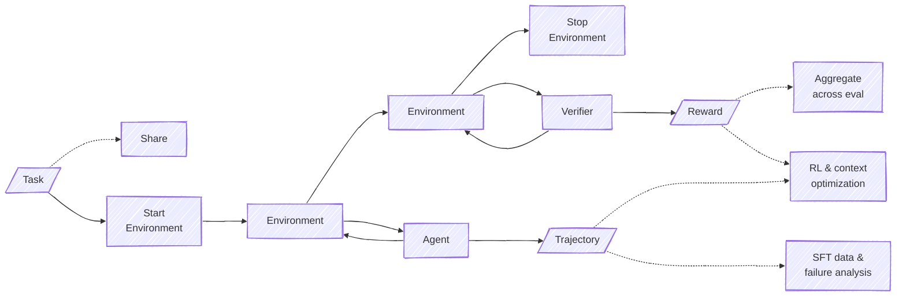

Harbor（智能体评测框架）中的 Task（任务）由指令、环境和测试脚本组成。任务以文件目录形式定义，结构如下：

```bash
my-task/
├── instruction.md
├── task.toml
├── environment/
│   ├── Dockerfile  # or some other spec
│   └── ...
├── solution/
│   ├── solve.sh
│   └── ...
└── tests/
    ├── test.sh
    └── ...
```

只要任务使用方（例如 Harbor 框架）支持，就可以使用任意规范定义环境。常见规范包括 `Dockerfile`、`docker-compose.yaml`（用于多容器环境）和 `Apptainer.def`（用于 HPC）。

## Trial（单次运行） {#trials}

Harbor Trial 是智能体尝试完成某个 Task 的一次运行。下图展示了任务组件在 Trial 中的使用方式。



## 奖励 {#rewards}

Task 会在 `tests/test.sh` 脚本中定义指令完成情况的验证逻辑并生成奖励。脚本必须在环境中的 `/logs/verifier/reward.txt` 写入数值奖励；多维或带标签的奖励则写入 `/logs/verifier/reward.json`。

## 独立、隔离且可复现 {#independent%2C-isolated%2C-and-reproducible}

Harbor 任务是独立、隔离且可复现的代码单元。任务本身不依赖 Harbor 框架，可以轻松接入任何支持 Harbor 格式的框架。不过，Harbor 框架可以帮助你快速开始大规模运行任务。

可以将任务视为软件包：它们应当自包含、进行版本管理，并持续维护和开发。

## 任务组件 {#task-components}

- [`instruction.md`](/tasks/instruction)
- [`task.toml`](/tasks/configuration)
- [`environment/`](/tasks/environment)
- [`solution/`](/tasks/solution)
- [`tests/`](/tasks/verifier)

## 多步骤任务 {#multi-step-tasks}

Harbor 任务可以拆分为多个步骤，每步都有自己的指令、测试和解决方案。多步骤任务适合为长周期任务设定里程碑、测试记忆等持续学习方法，并观察智能体基于先前工作继续推进的能力。

详细说明请参阅[多步骤任务](/tasks/multi-step)。

```bash
my-task/
├── task.toml
├── environment/
│   ├── Dockerfile  # or some other spec
│   └── ...
├── tests/
│   ├── helpers.py
│   └── ...
└── steps/
    ├── step-1/
    │   ├── instruction.md
    │   ├── tests/
    │   │   ├── test.sh
    │   │   └── ...
    │   ├── solution/
    │   │   ├── solve.sh
    │   │   └── ...
    │   └── workdir/
    │       ├── setup.sh
    │       └── ...
    └── step-2/
        └── ...
```

`Dockerfile` 可以替换为其他受支持的环境规范。`tests/helpers.py` 中的共享评分工具和各步骤的 `workdir/setup.sh` 脚本均为可选项。目录中也可以包含其他辅助文件。

每个步骤的测试脚本都可以使用共享工具。没有独立测试脚本的步骤可以回退使用基础文件 `tests/test.sh`；如果某一步有自己的 `test.sh`，则优先使用该脚本。

## 本地开发文件 {#local-development-files}

可以在 `tests/` 或 `solution/` 中添加 `.harborignore`，也可以将其放在步骤目录中，以便从沙箱上传、发布和内容哈希中排除本地文件。忽略文件本身也不会包含在内。

匹配模式遵循 Git（版本控制工具） ignore 语法，路径相对于各自的忽略文件。除非整个父目录已被排除，否则嵌套规则可以覆盖父规则。位于 tests 和 solution 目录之外的忽略文件不会生效。

例如，可以使用嵌套忽略文件保留 `expected.txt`：

```text
tests/
├── .harborignore
├── test.sh
└── fixtures/
    ├── .harborignore
    ├── expected.txt
    └── draft.txt
```

<Card>
<Tabs sync={false}>
  <Tab title="错误示例">
    ```gitignore title="tests/.harborignore"
    /fixtures/
    ```

    ```gitignore title="tests/fixtures/.harborignore"
    !expected.txt
    ```

    Harbor 会完全跳过 `fixtures/`，因此不会读取嵌套规则。两个 fixture 文件都会被排除。
  </Tab>

  <Tab title="正确示例">
    ```gitignore title="tests/.harborignore"
    /fixtures/*.txt
    ```

    ```gitignore title="tests/fixtures/.harborignore"
    !expected.txt
    ```

    Harbor 会读取嵌套规则并保留 `expected.txt`。只有 `draft.txt` 会被排除。
  </Tab>
</Tabs>
</Card>

镜像构建会使用构建工具的忽略规则，例如 `.dockerignore`。因此，使用独立验证器时，应同时为本地开发文件配置 `.dockerignore` 和 `.harborignore`。

基本排除和嵌套规则示例请参阅[可运行示例](https://github.com/harbor-framework/harbor/tree/main/examples/tasks/hello-harborignore)。
